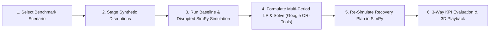
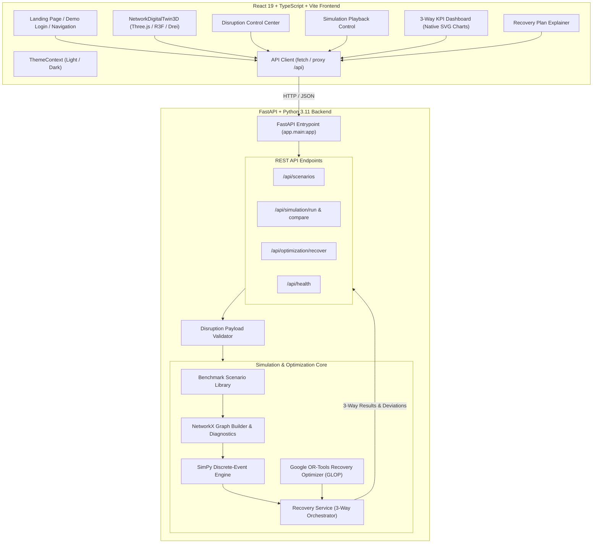

# ResilienceSim 3D
### AI-Powered Supply Chain Resilience & Recovery Simulator

[](https://fastapi.tiangolo.com)
[](https://react.dev)
[](https://www.typescriptlang.org)
[](https://threejs.org)
[](https://simpy.readthedocs.io)
[](https://developers.google.com/optimization)
[](https://pytest.org)

**ResilienceSim 3D** is an interactive supply-chain digital twin and decision-support command center. It models multi-tier global supply chains as directed spatial graphs, simulates temporal logistics and shock propagation using discrete-event simulation (**SimPy**), and computes mathematically constrained recovery rerouting using linear programming (**Google OR-Tools GLOP**).

All three operating states—**Healthy Baseline**, **Unmitigated Disruption**, and **Optimized Recovery**—are compared across key performance indicators (service level, delivered units, unmet demand, and transport logistics cost) and rendered in an interactive 3D WebGL network with step-by-step simulation playback and recovery explainability.

---

## Table of Contents

1. [Project Overview](#1-project-overview)
2. [Problem Statement](#2-problem-statement)
3. [Objectives & Use Cases](#3-objectives--use-cases)
4. [Implemented vs. Planned Features](#4-implemented-vs-planned-features)
5. [End-to-End Workflow](#5-end-to-end-workflow)
6. [Technical Methodology & Mathematical Formulation](#6-technical-methodology--mathematical-formulation)
7. [Technology Stack](#7-technology-stack)
8. [System Architecture](#8-system-architecture)
9. [Project Structure](#9-project-structure)
10. [Installation Prerequisites](#10-installation-prerequisites)
11. [Complete Windows Setup Instructions](#11-complete-windows-setup-instructions)
12. [API Reference & OpenAPI Docs](#12-api-reference--openapi-docs)
13. [Simulation Metrics & KPI Formulas](#13-simulation-metrics--kpi-formulas)
14. [Recovery Result Interpretation & Physical Tradeoffs](#14-recovery-result-interpretation--physical-tradeoffs)
15. [Automated Testing & Validation](#15-automated-testing--validation)
16. [Known Limitations & Modeling Assumptions](#16-known-limitations--modeling-assumptions)
17. [Project Roadmap](#17-project-roadmap)
18. [Collaborator & Contribution Guidelines](#18-collaborator--contribution-guidelines)
19. [Security & Credentials](#19-security--credentials)
20. [License](#20-license)
21. [Demonstration & Screenshots](#21-demonstration--screenshots)

---

## 1. Project Overview

Global supply chains are exposed to compound disruptions: factory shutdowns, port congestion, shipping canal blockades, geopolitical conflicts, and extreme weather. When an outage occurs, supply-chain leaders face difficult questions:
- *Which downstream regional distribution centers and retailers will run out of inventory first?*
- *How many customer orders will go unfulfilled if no action is taken?*
- *Can inventory be rerouted through alternative routes or sister manufacturing facilities without violating throughput constraints?*
- *What will the recovery plan cost, and is it mathematically and physically feasible?*

**ResilienceSim 3D** provides a digital sandbox where logistics directors and emergency response teams can evaluate synthetic shocks, compare counterfactual outcomes, and compute optimal recovery plans before deploying costly physical interventions.

---

## 2. Problem Statement

A supply network is a directed multi-echelon flow network. Upstream disruptions propagate downstream with temporal lag dictated by lead times:
- An outage at a Tier-1 silicon fab today might not starve regional assembly factories for 3 to 5 periods.
- Once local buffer stock is exhausted, manufacturing stalls, starving downstream distribution centers and creating a **bullwhip cascade**.
- Naive emergency rerouting often overloads alternative transit corridors or distribution centers, incurring exorbitant expedited shipping fees while still leaving retailers starved.

ResilienceSim 3D addresses this by coupling **NetworkX directed graph topology**, **SimPy discrete-event physical simulation**, and **Google OR-Tools time-expanded linear programming**.

---

## 3. Objectives & Use Cases

### Principal Objectives
1. **End-to-End Visibility:** Visualize multi-tier supply networks in an interactive 3D WebGL scene with real-time health badges and inventory levels.
2. **Deterministic Shock Evaluation:** Quantify the exact impact of single or simultaneous disruptions on service level, order backlogs, and total transit costs.
3. **Optimized Rerouting:** Formulate and solve multi-period recovery plans that maximize deliveries and minimize shipping costs within strict physical capacity constraints.
4. **Physical Re-Simulation Validation:** Re-run the discrete-event simulation engine enforcing the optimizer's decisions to guarantee that plans do not violate inventory or processing bounds in practice.

### Realistic Use Cases
- **Enterprise Resilience Stress Testing:** Evaluate vulnerability to single-point-of-failure facilities or key transit chokepoints (e.g., Malacca Strait closure, port labor disputes).
- **Executive Emergency Response:** Generate immediate rerouting schedules when a supplier or factory goes offline.
- **Supply Chain Education & Hackathon Demo:** Demonstrate operations research and discrete-event simulation concepts through an intuitive 3D interface.

---

## 4. Implemented vs. Planned Features

### ✅ Verified Implemented Functionality

| Capability | Implementation Detail |
| :--- | :--- |
| **Benchmark Scenarios** | Multi-tier **Global High-Tech Electronics** (14 facilities, 18 routes) and **Pharma Cold-Chain** (10 facilities, 13 routes). |
| **3D Digital Twin** | Spatial 3D graph layout with Three.js, React Three Fiber, Drei, OrbitControls, interactive node/edge inspection, and dynamic camera framing. |
| **Disruption Engine** | 5 shock types: `facility_shutdown`, `route_closure`, `capacity_reduction`, `lead_time_increase`, and `demand_surge`. |
| **Discrete-Event Simulation** | SimPy 4 engine simulating replenishment orders, transit lead times, capacity limits, and daily inventory balance. |
| **Constrained Optimization** | Time-expanded multi-period LP formulated with Google OR-Tools (GLOP solver) optimizing route dispatches and minimizing demand backlogs. |
| **3-Way KPI Comparison** | Real-time scorecards and native SVG charts comparing **Baseline vs. Disrupted vs. Recovered** across all planning periods. |
| **Simulation Playback** | Period scrubber, play/pause controls, variable playback speed (1x/2x/4x), and active state switcher. |
| **Plan Explainability** | Actionable recovery dispatches table, solver status, bottleneck identification, and execution deviation alerts. |
| **Enterprise Navigation** | Landing page, demo authentication modal with one-click credential prefill, and branded loading screen. |
| **Dual-Theme System** | First-class **Light Mode** and **Dark Mode** with zero-flicker initialization, CSS tokens, and Three.js canvas synchronization. |
| **Comprehensive Tests** | 63 automated backend tests across models, graph algorithms, simulation invariants, optimization, and API endpoints. |

### 📋 Planned Roadmap Features (Not Yet Implemented)
- Stochastic demand distributions and monte-carlo confidence intervals.
- Custom scenario builder with user-uploaded CSV / JSON graph definitions.
- Multi-commodity flow modeling (supporting distinct SKUs per facility).
- Exportable PDF / Excel resilience incident reports.
- Non-linear transportation cost curves and mixed-integer quadratic optimization (SCIP/CBC).

---

## 5. End-to-End Workflow



1. **Scenario Selection:** The user selects a benchmark supply network (`global_electronics` or `pharma_cold_chain`). The NetworkX graph and deterministic 3D positions are loaded into the Three.js viewport.
2. **Disruption Staging:** The user selects a curated preset (e.g., "Taiwan Fab Outage & Trans-Pacific Bottleneck") or creates custom shocks targeting facilities or transport routes.
3. **Simulation Execution:** SimPy evaluates healthy baseline performance and counterfactual disrupted behavior over the entire planning horizon (e.g., 14 or 21 days).
4. **Constrained Optimization:** Google OR-Tools builds a time-expanded linear program enforcing route capacities, lead times, factory processing limits, and inventory balance, minimizing unmet demand penalties and transit costs.
5. **Execution Verification:** The proposed dispatch plan is fed back into SimPy as an operational schedule. SimPy verifies physical feasibility and records any execution deviations.
6. **3-Way Analysis:** The KPI dashboard displays comparative scorecards, percentage deltas, per-period inventory trajectories, and interactive 3D playback.

---

## 6. Technical Methodology & Mathematical Formulation

### 1. Directed Supply Network Graph
The network is modeled as a directed graph $G = (V, E)$ using **NetworkX**:
- **Nodes ($v \in V$):** Facilities categorized by tier (`supplier`, `factory`, `distribution_center`, `warehouse`, `retailer`). Each node has properties: $\text{initial\_inventory}$, $\text{processing\_capacity}$, $\text{supply\_capacity}$, and 3D spatial coordinates $(x, y, z)$.
- **Edges ($e = (u, v) \in E$):** Transport routes with $\text{capacity}$, $\text{lead\_time\_periods}$, $\text{cost\_per\_unit}$, and operational status (`active`, `congested`, `blocked`).

### 2. Discrete-Event Simulation Dynamics (SimPy)
For each period $t \in \{0, \dots, T-1\}$:
1. **Disruption State Updates:** Apply active disruption factors (status overrides, capacity multipliers, lead-time offsets).
2. **Inbound Shipment Arrivals:** Shipments dispatched at $t - \text{lead\_time}$ arrive and replenish facility inventory:
   $$I_{f, t} = I_{f, t}^{\text{prev}} + \sum_{\text{arrivals}} Q_{\text{shipment}}$$
3. **Replenishment Dispatch:** Intermediate facilities issue replenishment orders to upstream tiers constrained by processing limits and available stock.
4. **Retailer Fulfillment:** Retailers satisfy incoming customer demand and backlogged orders from available inventory:
   $$\text{Delivered}_{r, t} = \min(I_{r, t}, \text{Demand}_{r, t} + \text{Backlog}_{r, t-1})$$
   $$\text{Backlog}_{r, t} = \text{Backlog}_{r, t-1} + \text{Demand}_{r, t} - \text{Delivered}_{r, t}$$
   $$I_{r, t} \leftarrow I_{r, t} - \text{Delivered}_{r, t}$$

### 3. Google OR-Tools Recovery Optimization Formulation
The recovery problem is formulated as a multi-period, time-expanded linear program and solved using **Google OR-Tools GLOP**:

#### Decision Variables:
- $x_{e, t} \ge 0$: Units dispatched along route $e \in E$ at period $t \in [0, T-1]$.
- $\text{inv}_{f, t} \ge 0$: Inventory held at facility $f \in V$ at the end of period $t$.
- $\text{shortage}_{r, t} \ge 0$: Cumulative unmet demand backlog at retailer $r$ at period $t$.
- $\text{delivered}_{r, t} \ge 0$: Quantity delivered to end customers at retailer $r$ at period $t$.

#### Objective Function:
$$\min \sum_{r \in \text{Retailers}} \sum_{t=0}^{T-1} \left( P_{\text{shortage}} \cdot \text{shortage}_{r, t} \right) + \sum_{e \in E} \sum_{t=0}^{T-1} \left( c_e \cdot x_{e, t} \right)$$
*(where default shortage penalty $P_{\text{shortage}} = 1000.0$ and $c_e$ is route transport cost per unit)*.

#### Constraints:
1. **Route Capacity Bounds:**
   $$0 \le x_{e, t} \le \text{Cap}_e \cdot \mu_{e, t} \quad \forall e \in E, t \in [0, T-1]$$
   *(where $\mu_{e, t} = 0$ if route or source facility is disabled, or reduced by capacity disruptions)*.
2. **Supplier Daily Capacity:**
   $$\text{inv}_{s, t} - \text{inv}_{s, t-1} + \sum_{e \in \delta^+(s)} x_{e, t} = \text{SupplyCap}_{s, t} \quad \forall s \in \text{Suppliers}$$
3. **Factory & Distribution Center Throughput Limit:**
   $$\sum_{e \in \delta^+(f)} x_{e, t} \le \text{ProcessingCap}_{f, t} \quad \forall f \in \{\text{Factories, DCs}\}$$
4. **Intermediate Facility Inventory Conservation:**
   $$\text{inv}_{f, t} - \text{inv}_{f, t-1} + \sum_{e \in \delta^+(f)} x_{e, t} - \sum_{e \in \delta^-(f)} x_{e, t - \tau_e} = 0 \quad (\text{with } \text{inv}_{f, -1} = I_{f}^{\text{init}})$$
5. **Retailer Backlog Conservation:**
   $$\text{shortage}_{r, t} - \text{shortage}_{r, t-1} + \text{delivered}_{r, t} = \text{Demand}_{r, t} \quad \forall r \in \text{Retailers}$$
6. **Retailer Inventory Balance:**
   $$\text{inv}_{r, t} - \text{inv}_{r, t-1} + \text{delivered}_{r, t} - \sum_{e \in \delta^-(r)} x_{e, t - \tau_e} = 0 \quad (\text{with } \text{inv}_{r, -1} = I_{r}^{\text{init}})$$

---

## 7. Technology Stack

| Layer | Technology | Version | Purpose in ResilienceSim 3D |
| :--- | :--- | :--- | :--- |
| **Frontend Framework** | **React** | `^19.2.8` | Declarative UI, state management, and component hierarchy. |
| **Language** | **TypeScript** | `~6.0.2` | End-to-end static typing for models, API payloads, and state. |
| **Bundler & Tooling** | **Vite** | `^8.3.0` | Ultra-fast HMR development server and optimized Rollup build. |
| **3D Rendering** | **Three.js** | `^0.186.1` | WebGL scene graph, geometry meshes, materials, and lighting. |
| **React 3D Integration** | **React Three Fiber** | `^9.8.1` | React reconciler for declarative Three.js scene creation. |
| **3D Utilities** | **Drei** | `^10.7.9` | OrbitControls, HTML scene overlays, and camera helpers. |
| **Icons** | **Lucide React** | `^1.55.0` | Accessible, consistent SVG iconography across all controls. |
| **Backend Framework** | **FastAPI** | `>=0.110.0` | High-performance asynchronous REST API with auto OpenAPI docs. |
| **ASGI Server** | **Uvicorn** | `>=0.28.0` | Production ASGI web server running FastAPI. |
| **Data Validation** | **Pydantic** | `>=2.6.0` | Schema validation, type enforcement, and serialization. |
| **Graph Modeling** | **NetworkX** | `>=3.2.1` | Directed supply chain graph representation and diagnostics. |
| **Simulation Engine** | **SimPy** | `>=4.1.1` | Process-based discrete-event supply chain simulation. |
| **Optimization Solver** | **Google OR-Tools** | `>=9.9.3963` | Time-expanded linear programming recovery engine (GLOP). |
| **Backend Testing** | **pytest** | `>=8.1.0` | Automated unit, regression, and end-to-end resilience tests. |
| **HTTP Client (Test)** | **HTTPX** | `>=0.27.0` | Synchronous and asynchronous API test client. |

---

## 8. System Architecture



---

## 9. Project Structure

```text
ai supply chain resilience simulator/
├── .env.example                     # Environment template for custom host/port bindings
├── .gitignore                       # Clean Git exclusion rules (venv, node_modules, caches)
├── CONTRIBUTING.md                  # Development guidelines, standards, and PR protocols
├── README.md                        # Master project documentation
│
├── backend/                         # Python FastAPI Backend
│   ├── app/
│   │   ├── api/
│   │   │   ├── routes_optimization.py   # POST /api/optimization/recover handler
│   │   │   ├── routes_scenarios.py      # GET /api/scenarios and graph endpoints
│   │   │   ├── routes_simulation.py     # POST /api/simulation/run and compare endpoints
│   │   │   └── validation.py            # Disruption temporal and target validator
│   │   ├── core/
│   │   │   ├── config.py                # Application settings and CORS policies
│   │   │   └── graph_builder.py         # NetworkX graph construction & 3D layout generator
│   │   ├── models/
│   │   │   ├── common.py                # Enums (FacilityType, OperationalStatus, RouteStatus)
│   │   │   ├── disruption.py            # Disruption models, types, and magnitude validator
│   │   │   ├── facility.py              # Facility schema (capacities, inventory, coords)
│   │   │   ├── graph.py                 # Graph node/edge serialization schemas
│   │   │   ├── optimization.py          # Recovery dispatch plans, actions, solver statuses
│   │   │   ├── route.py                 # TransportRoute schema (lead times, costs, capacities)
│   │   │   ├── scenario.py              # Scenario definitions and summary schemas
│   │   │   └── simulation.py            # Simulation results, period metrics, deltas
│   │   ├── optimization/
│   │   │   ├── recovery_optimizer.py    # Google OR-Tools multi-period time-expanded LP
│   │   │   └── recovery_service.py      # 3-way recovery orchestrator (baseline/disrupted/recovered)
│   │   ├── scenarios/
│   │   │   └── benchmark_scenarios.py   # Global Electronics & Pharma benchmark networks
│   │   ├── simulation/
│   │   │   ├── comparison.py            # Baseline vs. Disrupted simulation runner
│   │   │   └── simpy_engine.py          # Discrete-event SimPy multi-period simulation engine
│   │   └── main.py                      # FastAPI application entrypoint and health route
│   ├── tests/                           # 63 Automated Test Cases
│   │   ├── test_api.py                  # Health check & root endpoints
│   │   ├── test_domain_models.py        # Pydantic entity validation & invariant tests
│   │   ├── test_e2e_resilience.py       # End-to-end resilience scenarios & regression guards
│   │   ├── test_graph_builder.py        # NetworkX graph diagnostics & spatial 3D coordinates
│   │   ├── test_optimization.py         # OR-Tools LP constraints, rerouting, & SimPy execution
│   │   ├── test_scenarios_api.py        # Scenario listing & graph endpoints
│   │   └── test_simulation.py          # SimPy replenishment, lead times, & 5 disruption types
│   ├── pytest.ini                       # Pytest path and directory configuration
│   └── requirements.txt                 # Pinned Python package dependencies
│
├── docs/                            # Architectural & Implementation Reports
│   ├── HACKATHON_DEMO.md                # 5-minute judge presentation script & key takeaways
│   ├── PHASE_7_UI_AND_AUTH_REPORT.md    # Landing page, auth, and loading screen documentation
│   └── PHASE_8_THEME_IMPLEMENTATION_REPORT.md # Light/Dark theme design token documentation
│
└── frontend/                        # React 19 + TypeScript + Vite Frontend
    ├── public/
    │   ├── favicon.svg                  # Brand favicon
    │   └── icons.svg                    # SVG icon sprites
    ├── src/
    │   ├── api/
    │   │   └── client.ts                # Strongly-typed fetch API client and error wrapper
    │   ├── assets/                      # Application assets
    │   ├── components/
    │   │   ├── auth/                    # Demo Login Page and modal components
    │   │   ├── landing/                 # Enterprise Landing Page with interactive SVG preview
    │   │   ├── loading/                 # Branded Workspace Loading Screen with delivery track
    │   │   ├── DisruptionControlCenter.tsx # Interactive shock configuration and preset chips
    │   │   ├── InspectorPanel.tsx       # Node and edge detail inspector
    │   │   ├── KpiDashboard.tsx         # 3-Way scorecards, delta pills, and native SVG line charts
    │   │   ├── NavigationHeader.tsx     # Header bar with session, health, reset, and theme toggle
    │   │   ├── NetworkDigitalTwin3D.tsx # Three.js / R3F / Drei interactive 3D digital twin
    │   │   ├── RecoveryPlanExplainer.tsx# Recovery dispatch plan tables and deviation explanations
    │   │   ├── ScenarioSelector.tsx     # Scenario picker and tier statistics strip
    │   │   ├── SimulationPlaybackControl.tsx # Scrubber, speed buttons, and view mode selector
    │   │   └── ThemeToggle.tsx          # Accessible Sun/Moon toggle button
    │   ├── context/
    │   │   └── ThemeContext.tsx         # Typed theme provider (Light / Dark) & localStorage sync
    │   ├── hooks/
    │   │   └── useNavigation.ts         # View state management ('landing', 'login', 'loading', 'workspace')
    │   ├── services/
    │   │   └── authService.ts           # Demo authentication service and prefilled credentials
    │   ├── types/
    │   │   ├── auth.ts                  # User and session types
    │   │   └── models.ts                # TypeScript interfaces mirroring backend Pydantic models
    │   ├── App.css                      # Workspace styles, HUD overlays, cards, scorecards
    │   ├── App.tsx                      # Primary application controller and state orchestrator
    │   ├── index.css                    # Design token system (:root and [data-theme="dark"])
    │   └── main.tsx                     # React root mount with ThemeProvider wrapper
    ├── index.html                       # HTML shell with anti-flash theme script
    ├── package.json                     # Frontend npm dependencies and scripts
    ├── tsconfig.json                    # TypeScript compiler configuration
    └── vite.config.ts                   # Vite configuration with proxy and Rollup vendor chunking
```

---

## 10. Installation Prerequisites

Before installing, ensure your environment has:
- **Operating System:** Windows 10 or Windows 11 (64-bit).
- **Python:** Python 3.11+ (verified on Python 3.11.9).
  - Verify via PowerShell: `py -3.11 --version` or `python --version`.
- **Node.js & npm:** Node.js v18.0.0+ (verified on v24.14.1) with npm 9.0.0+ (verified on 11.11.0).
  - Verify via PowerShell: `node --version` and `npm --version`.
- **Git:** Git 2.30+ for cloning and version control.
- **Terminal:** Windows PowerShell or PowerShell 7.

---

## 11. Complete Windows Setup Instructions

Follow these step-by-step instructions in **two separate PowerShell terminals**.

### Step 1: Clone the Repository

```powershell
git clone <repository-url>
cd "ai supply chain resilience simulator"
```

---

### Step 2: Set Up and Run the Backend (Terminal 1)

In your first PowerShell window:

```powershell
# 1. Navigate to the backend directory
cd "backend"

# 2. Create a virtual environment using Python 3.11
py -3.11 -m venv venv
# (If py launcher is not available, run: python -m venv venv)

# 3. Activate the virtual environment
.\venv\Scripts\Activate.ps1
# NOTE: If PowerShell displays an ExecutionPolicy error, run:
# Set-ExecutionPolicy -Scope Process -ExecutionPolicy RemoteSigned
# and try activating again.

# 4. Install all dependencies
pip install --upgrade pip
pip install -r requirements.txt

# 5. Start the FastAPI development server
uvicorn app.main:app --reload --port 8000
```

Verify backend execution:
- **Health Check:** Open [http://127.0.0.1:8000/api/health](http://127.0.0.1:8000/api/health) (should return `{"status":"healthy", ...}`)
- **Interactive Swagger Docs:** Open [http://127.0.0.1:8000/docs](http://127.0.0.1:8000/docs)

---

### Step 3: Set Up and Run the Frontend (Terminal 2)

In a **second** PowerShell window:

```powershell
# 1. Navigate to the frontend directory
cd "ai supply chain resilience simulator\frontend"

# 2. Install all Node dependencies
npm install

# 3. Start the Vite development server
npm run dev
```

The frontend will start at: [http://localhost:5173](http://localhost:5173).

---

### Step 4: Access the Application & Demo Credentials

1. Open your browser and navigate to **`http://localhost:5173`**.
2. On the **Landing Page**, click **"Sign In"** or **"Launch Digital Twin"**.
3. On the **Login Page**, click **"Fill Demo Credentials"** (or click **"Sign In with Demo Account"** directly):
   - **Demo Email:** `demo.analyst@resiliencesim.internal`
   - **Demo Password:** `Resilience2026!`
4. After the branded workspace initialization finishes, you will enter the **Digital Twin Command Center**.

---

### Common Setup Issues & Practical Fixes

| Issue | Cause | Fix |
| :--- | :--- | :--- |
| `Activate.ps1 cannot be loaded because running scripts is disabled` | Windows PowerShell execution policy restriction. | Run `Set-ExecutionPolicy -Scope Process -ExecutionPolicy RemoteSigned` in your PowerShell terminal, then re-run `.\venv\Scripts\Activate.ps1`. |
| `python : The term 'python' is not recognized` | Python is installed via Windows Launcher but not added to system `PATH`. | Use `py -3.11 -m venv venv` or `py -m venv venv` to create the virtual environment. |
| `Failed to fetch from /api/health` | Backend server is not running on port 8000. | Ensure Terminal 1 is running `uvicorn app.main:app --reload --port 8000` without errors. |
| Port 8000 or 5173 already in use | Another local process is binding to the port. | Terminate the occupying process or run uvicorn on another port (e.g. `--port 8001`) and update `frontend/vite.config.ts`. |

---

## 12. API Reference & OpenAPI Docs

The backend exposes strongly-typed REST endpoints documented interactively via OpenAPI at **`http://127.0.0.1:8000/docs`**.

| Method | Endpoint | Description | Request Body | Response Model |
| :--- | :--- | :--- | :--- | :--- |
| `GET` | `/` | Root service info and links | None | Service metadata |
| `GET` | `/api/health` | Service health status & server UTC timestamp | None | `HealthResponse` |
| `GET` | `/api/scenarios` | List benchmark scenarios with node/route counts | None | `List[ScenarioSummary]` |
| `GET` | `/api/scenarios/{id}` | Full scenario definition including initial disruptions | Path parameter | `Scenario` |
| `GET` | `/api/scenarios/{id}/graph` | NetworkX processed nodes, edges, & 3D coordinates | Path parameter | `GraphResponse` |
| `POST` | `/api/simulation/run` | Run a single SimPy discrete-event simulation run | `SimulationRequest` | `SimulationResult` |
| `POST` | `/api/simulation/compare` | Compare healthy baseline against counterfactual shock | `ComparisonRequest` | `ComparisonResult` |
| `POST` | `/api/optimization/recover` | Solve OR-Tools LP, re-simulate in SimPy, return 3-way KPIs | `OptimizationRequest` | `OptimizationRecoveryResponse` |

---

## 13. Simulation Metrics & KPI Formulas

The platform evaluates performance across three states using standardized operational metrics:

### 1. Total Customer Demand ($\text{Demand}_{\text{total}}$)
The cumulative sum of all customer order quantities requested across all retailer demand nodes over the planning horizon:
$$\text{Demand}_{\text{total}} = \sum_{r \in \text{Retailers}} \sum_{t=0}^{T-1} \text{Demand}_{r, t}$$

### 2. Total Delivered Units ($\text{Delivered}_{\text{total}}$)
The exact number of physical units fulfilled and delivered to end-customer retail locations:
$$\text{Delivered}_{\text{total}} = \sum_{r \in \text{Retailers}} \sum_{t=0}^{T-1} \text{Delivered}_{r, t}$$

### 3. Service Level Percentage ($\text{SL}_{\%}$)
The primary metric measuring customer fulfillment integrity:
$$\text{SL}_{\%} = \left( \frac{\text{Delivered}_{\text{total}}}{\text{Demand}_{\text{total}}} \right) \times 100\%$$

### 4. Total Unmet Demand / Cumulative Backlog ($\text{Shortage}_{\text{total}}$)
The cumulative order backlog across retailers at the end of the planning horizon:
$$\text{Shortage}_{\text{total}} = \sum_{r \in \text{Retailers}} \text{Backlog}_{r, T-1}$$

### 5. Total Transportation Cost ($\text{Cost}_{\text{transport}}$)
Total variable logistics expense incurred by dispatching volume across all transport routes:
$$\text{Cost}_{\text{transport}} = \sum_{e \in E} \sum_{\text{shipments } s \in e} \left( Q_s \cdot \text{CostPerUnit}_e \right)$$

### 6. In-Transit Units ($\text{InTransit}$)
Total volume that has departed an upstream facility but has not yet arrived at its destination because the route lead time extends past the planning horizon boundary.

### 7. Execution Deviations ($\text{Deviations}$)
A critical validation metric: the number of dispatch instructions proposed by the linear optimizer that could not be executed by SimPy because the upstream facility lacked sufficient physical inventory or throughput capacity at that exact period.

---

## 14. Recovery Result Interpretation & Physical Tradeoffs

ResilienceSim 3D enforces **honest, physics-based reporting**. Results are not hardcoded or artificially inflated:

1. **Comparable Inputs:** Baseline, Disrupted, and Recovered states are evaluated over the exact same planning horizon and random seed, with the exact same initial inventories and customer demand schedules.
2. **Transportation Cost vs. Service Level Tradeoff:** Rerouting shipments through air cargo, secondary distribution centers, or longer alternative paths frequently increases total transportation costs. A recovery plan that increases service level from 36% to 75% will legitimately reflect higher logistics expenditures.
3. **Severe Upstream Starvation:** When a sole-source supplier (e.g., semiconductor fab) shuts down for the entire horizon with zero alternative raw material sources, the optimizer cannot synthesize inventory out of thin air. In such cases, the optimizer correctly reports bottleneck constraints, and service level improvements may be modest or limited to redistributing existing network buffer stock.
4. **Execution Deviations Guard:** If the optimizer proposes dispatches that violate discrete timing or capacity bounds, SimPy flags `execution_deviations` and surfaces clear warning banners in the UI rather than pretending the execution was flawless.

---

## 15. Automated Testing & Validation

All domain models, physical simulation invariants, optimization constraints, and API contracts are guarded by automated tests.

### Running Backend Tests
From the `backend` directory with the virtual environment activated:

```powershell
pytest -v
```

### Verified Test Results
```text
============================= test session starts =============================
platform win32 -- Python 3.11.9, pytest-8.4.2
collected 63 items

tests/test_api.py::test_read_root PASSED                                 [  1%]
tests/test_api.py::test_health_check_endpoint PASSED                     [  3%]
tests/test_api.py::test_critical_dependencies_import PASSED              [  4%]
tests/test_domain_models.py::test_valid_facility_creation PASSED         [  6%]
tests/test_domain_models.py::test_facility_negative_capacity_rejected PASSED [  7%]
tests/test_domain_models.py::test_facility_empty_id_rejected PASSED      [  9%]
tests/test_domain_models.py::test_valid_transport_route_creation PASSED  [ 11%]
tests/test_domain_models.py::test_transport_route_self_loop_rejected PASSED [ 12%]
tests/test_domain_models.py::test_transport_route_non_positive_lead_time_rejected PASSED [ 14%]
tests/test_domain_models.py::test_disruption_magnitude_validation PASSED [ 15%]
tests/test_domain_models.py::test_scenario_duplicate_facility_rejected PASSED [ 17%]
tests/test_domain_models.py::test_scenario_unknown_route_endpoint_rejected PASSED [ 19%]
tests/test_domain_models.py::test_scenario_duplicate_directed_routes_rejected PASSED [ 20%]
tests/test_e2e_resilience.py::test_electronics_preset_targets_exist PASSED [ 22%]
tests/test_e2e_resilience.py::test_pharma_preset_targets_exist PASSED    [ 23%]
tests/test_e2e_resilience.py::test_case_1_feasible_recovery_rerouting_improves_service PASSED [ 25%]
tests/test_e2e_resilience.py::test_case_2_unavoidable_shortage_honest_bottlenecks PASSED [ 26%]
tests/test_e2e_resilience.py::test_conservation_and_physical_invariants PASSED [ 28%]
tests/test_e2e_resilience.py::test_deterministic_experiment_repeatability PASSED [ 30%]
tests/test_e2e_resilience.py::test_api_rejects_invalid_disruption_target PASSED [ 31%]
tests/test_e2e_resilience.py::test_api_rejects_demand_surge_on_non_retailer PASSED [ 33%]
tests/test_e2e_resilience.py::test_api_rejects_out_of_bounds_start_period PASSED [ 34%]
tests/test_e2e_resilience.py::test_hand_checkable_feasible_recovery_fixture PASSED [ 36%]
tests/test_e2e_resilience.py::test_regression_no_silent_degradation_when_recovery_worse PASSED [ 38%]
tests/test_graph_builder.py::test_build_networkx_graph_preserves_attributes PASSED [ 39%]
tests/test_graph_builder.py::test_compute_graph_diagnostics_healthy_network PASSED [ 41%]
tests/test_graph_builder.py::test_unreachable_demand_node_detection_without_deletion PASSED [ 42%]
tests/test_graph_builder.py::test_deterministic_3d_positions_stability_and_tiers PASSED [ 44%]
tests/test_graph_builder.py::test_preserves_explicit_user_position PASSED [ 46%]
tests/test_optimization.py::test_optimizer_hand_calculable_small_network PASSED [ 47%]
tests/test_optimization.py::test_closed_route_receives_zero_flow PASSED  [ 49%]
tests/test_optimization.py::test_facility_shutdown_respected_by_optimizer PASSED [ 50%]
tests/test_optimization.py::test_capacity_reduction_respected_by_optimizer PASSED [ 52%]
tests/test_optimization.py::test_unavoidable_shortage_handling_without_crash PASSED [ 53%]
tests/test_optimization.py::test_optimizer_reroutes_around_disrupted_route PASSED [ 55%]
tests/test_simpy_executes_recovery_plan PASSED                            [ 57%]
tests/test_execute_recovery_optimization_service PASSED                   [ 58%]
tests/test_api_optimize_recover_global_electronics PASSED                [ 60%]
tests/test_api_optimize_recover_pharma_cold_chain PASSED                 [ 61%]
tests/test_api_optimize_recover_scenario_not_found PASSED                [ 63%]
tests/test_scenarios_api.py::test_scenario_library_benchmarks PASSED     [ 65%]
tests/test_scenarios_api.py::test_list_scenarios_endpoint PASSED         [ 66%]
tests/test_scenarios_api.py::test_get_scenario_detail_electronics PASSED [ 68%]
tests/test_scenarios_api.py::test_get_scenario_detail_pharma PASSED      [ 69%]
tests/test_scenarios_api.py::test_get_scenario_graph_endpoint PASSED     [ 71%]
tests/test_scenarios_api.py::test_get_scenario_not_found PASSED          [ 73%]
tests/test_scenarios_api.py::test_get_scenario_graph_not_found PASSED    [ 74%]
tests/test_scenarios_api.py::test_health_check_endpoint_unaffected PASSED [ 76%]
tests/test_simulation.py::test_baseline_deterministic_and_repeatable PASSED [ 77%]
tests/test_simulation.py::test_zero_demand_handling PASSED               [ 79%]
tests/test_simulation.py::test_shipment_lead_time_and_in_transit_boundary PASSED [ 80%]
tests/test_simulation.py::test_inventory_non_negative_invariant PASSED   [ 82%]
tests/test_simulation.py::test_disruption_route_closure PASSED           [ 84%]
tests/test_simulation.py::test_disruption_facility_shutdown PASSED       [ 85%]
tests/test_simulation.py::test_disruption_capacity_reduction PASSED      [ 87%]
tests/test_simulation.py::test_disruption_lead_time_increase PASSED      [ 88%]
tests/test_simulation.py::test_disruption_demand_surge PASSED            [ 90%]
tests/test_simulation.py::test_multiple_simultaneous_disruptions PASSED  [ 92%]
tests/test_simulation.py::test_disruptions_do_not_mutate_original_scenario PASSED [ 93%]
tests/test_simulation.py::test_compare_simulations_service PASSED        [ 95%]
tests/test_simulation.py::test_api_simulation_run_endpoint PASSED        [ 96%]
tests/test_simulation.py::test_api_simulation_compare_endpoint PASSED    [ 98%]
tests/test_simulation.py::test_api_simulation_unknown_scenario_returns_404 PASSED [100%]

======================= 63 passed, 4 warnings in 1.89s ========================
```

### Running Frontend Production Build
From the `frontend` directory:

```powershell
npm run build
```

*Result:* `tsc -b && vite build` completes with **0 errors in ~1.35s**.

---

## 16. Known Limitations & Modeling Assumptions

1. **Deterministic Lead Times & Demands:** Current simulation periods operate with deterministic daily increments. Stochastic demand distributions and weather-driven variance are planned for future iterations.
2. **Single-Commodity Flow:** Materials are tracked as aggregated units per facility rather than multi-SKU BOM (Bill of Materials) part trees.
3. **Linear Cost Modeling:** The GLOP linear solver assumes constant per-unit transport costs rather than step-function container tariffs or economies of scale.
4. **Demo Authentication:** The client-side authentication service is designed for prototype evaluation with prefilled credentials; it does not connect to an enterprise OAuth/SAML provider.

---

## 17. Project Roadmap

- [ ] **Multi-SKU Bill of Materials (BOM):** Expand factory nodes to model multi-part assembly constraints (e.g., 2 chips + 1 PCB = 1 phone).
- [ ] **Stochastic Simulation Runs:** Monte Carlo simulation with variable demand curves and transit delay distributions.
- [ ] **Custom Scenario Graph Builder:** UI to drag-and-drop new nodes and configure route attributes directly on the 3D canvas.
- [ ] **Scenario Import/Export:** Import and export standard supply-chain formats (CSV / GeoJSON / JSON).
- [ ] **MIP / Quadratic Solvers:** Incorporate fixed route activation charges using Mixed-Integer Linear Programming (CBC / SCIP).

---

## 18. Collaborator & Contribution Guidelines

We welcome contributions! Please see [CONTRIBUTING.md](CONTRIBUTING.md) for full instructions on setting up your environment, running tests, branch naming standards, and opening pull requests.

---

## 19. Security & Credentials

- **No Secrets in Repository:** The application does not require external third-party API keys or cloud credentials to run locally.
- **Environment Isolation:** Do not commit `.env` files or virtual environments. A template is provided at `.env.example`.
- **Demo Mode Notice:** The credentials displayed on the login modal (`demo.analyst@resiliencesim.internal` / `Resilience2026!`) are prototype placeholders only and have no privileges outside the local client session.

---

## 20. License

*Note for Collaborators:* A formal open-source license (such as MIT or Apache-2.0) has not yet been selected. Please do not redistribute or publish this codebase publicly without explicit permission from the repository owner.

---

## 21. Demonstration & Screenshots

For a complete 5-minute hackathon presentation script, talking points, and judge Q&A preparation, consult **[docs/HACKATHON_DEMO.md](docs/HACKATHON_DEMO.md)**.

*To add screenshots to this repository:*
1. Capture screenshots of the **Landing Page**, **Interactive 3D Digital Twin**, **Disruption Control Center**, and **3-Way KPI Dashboard**.
2. Save them into `frontend/src/assets/` or `docs/screenshots/`.
3. Reference them using standard Markdown relative links: ``.
